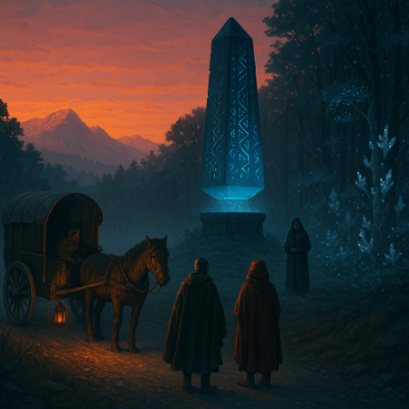

*The Guidestone on the road between Lemford and Lembrow.*

**Ancient Guidestones** are one of the most frequent reminders of the Erranite Empire's historical influence. These levitating bluestone obelisks can be found scattered across the lands once under Imperial rule. They vary in height (ranging 10-20ft) and specific inscriptions, though most have the bright blue glow that indicates still-active [runecraft](lore/magic).

Despite attempts to translate the runes, their purpose remains a mystery, though various plausible ideas have been suggested. One of the most popular theories is that they served as beacons or signposts for some magical navigation system, which is consistent with their being commonly located at crossroads. Meanwhile, some say that they were used for communication over great distances, and others think they are purely decorative.

## Known Locations

- Lembrow-Lemford Crossroads