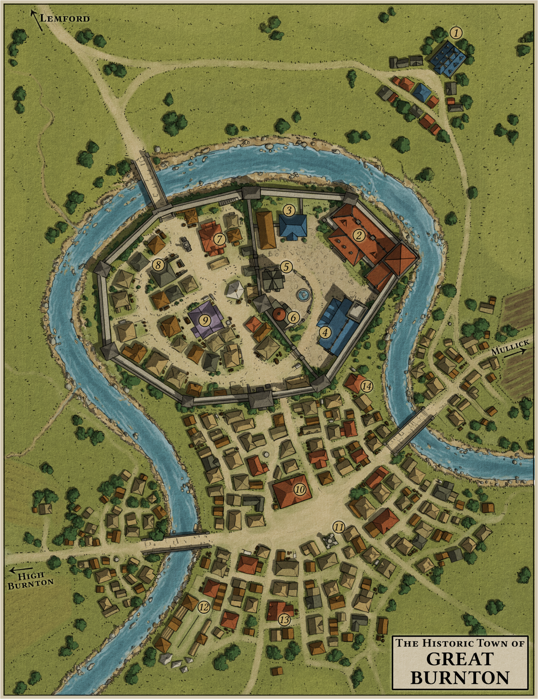

> History, Discovery, Legacy
>
> -- Motto of House de Burne

<!-- summary -->

The town of Great Burnton straddles the neck of a tight meander in the river Fastburne, which snakes through the rolling green pastureland separating the Valley of Lem from the Plains further south. As the largest settlement on the river, and the largest in the Valley, it serves as a hub of trade and commerce, and a valuable rest-stop, for those travelling in to and out of the Valley.

The economic heart of the town can be found within the high stone walls of Castle de Burne. The de Burne family have lived in Great Burnton for generations, serving as patrons of Blessed Defenders – whom they call “Knights Protector” – that have ensured the settlement’s continued survival.

<!-- /summary -->

# History

The patriarch of the family, Old Monstrance de Burne, who is commemorated by a statue just inside the North Gate of the Castle, was a prolific and highly successful Blessed Adventurer during the Years of Darkness. He came to occupy the abandoned fortress that would become Castle de Burne, presumably a relic of some forgotten earlier war, and it was soon filled with treasures from his expeditions West. This afforded his family great luxury in a time where such things were confined to tales of the past.

Upon his death, his descendants were left great fame and fortune. But it is his eldest daughter Ostentia to whom the family most owe their legacy and continued prosperity. Unlike many of her siblings, she was not Blessed. She also did not immediately squander her inheritance on frivolities and debauchery. She had the foresight to invest her share of her father’s hoard. She loaned use of some of the powerful Imperial Relics in the collection to local Blessed Adventurers, eventually hiring some as a permanent defensive force. She sponsored expeditions to the Blightwood, that would bring back more relics to the vaults, getting a return on her investment and more items to loan, hence the cycle continued and her wealth grew.

Thus the House of de Burne has continued be a significant player in the trade of Imperial Relics across Erran, throughout the Years of Darkness and into the Years of Longing beyond. This wealth, along with the prospect of protection under the aegis of the Knights Protector, has attracted numerous settlers over the years from far and wide to Castle de Burne, eventually leading to the self-governing town of Great Burnton as it known today.
Lord Wysham and Lady Catharine de Burne are the current rulers of the town.

# Notable Locations

*Map of Great Burnton*

Great Burnton is divided into two halves by the walls of Castle de Burne: the **Upper Town**, inside the castle walls, is the oldest and wealthiest half. The **Lower Town** spreads out to the south, where there is space for new construction. It is not *poor* per se, but certainly lacks the opulence and grandeur of the castle.

Each of the towns halves is governed by a **Steward**, an official appointed by his Lordship who represents the interested of their respective half at meetings of the Court. 

## Upper Town

### Great Burnton Sanatorium (1)

Blessed Mother Brinna Wellsworth heads the Sanatorium in Great Burnton, though the building is actually located outside the town proper, across the river from the keep of Castle de Burne. This is in accordance with the instructions of the House, who, while they understand the necessity of treating Silverblight, wish to keep the town a sanctuary totally free from the Blight, using the Knights Protector to do so if necessary.

Mother Wellsworth is known for her somewhat unconventional and experimental techniques when it comes to treating the afflicted – an unexpected benefit of the Sanatorium’s remoteness is that one cannot hear the screams!

### Ostentian Palace (2)

Construction of the palace began under the rule of Old Monstrance; his daughter Ostentia, the first Lady de Burne, oversaw its completion. It was not until after her death that it took her name. The vast interior is lavishly decorated with ornamental artefacts recovered from various expeditions over the years.

In addition to a Great Hall where the ruling Lord or Lady holds regular meetings of the Court (consisting mostly of stewards and bailiffs who administrate the local lands), the palace also features a ballroom, for events with visiting nobles or dignitaries (though these are infrequent nowadays), and a sizeable library whose collection of Ancient Imperial Texts might begin to rival that of Lightwarden Abbey.

### Residence of the Knights Protector (3)

In addition to a hefty annual stipend from the ruling Lord or Lady, the Knights Protectors of Great Burnton – the Blessed Defenders charged with protecting the town – are granted free enjoyment of this luxurious residence within the grounds of Castle de Burne. It boasts a private walled garden and an adjoining armoury and stables, fully staffed at his Lordship’s expense.

### Chapel of St. Idismund (4)

The presence of the Church of Brightwater has not always been welcomed in Great Burnton. There have been disagreements over ownership of relics and manuscripts of spiritual significance to the Church but discovered by those under the patronage and funding of the de Burne family. However, tensions were lessened after the children of Lord Armont (c. 150 YL) were cured of the Blight with Reversing Elixir provided by a visiting Blessed Mother. The Church were welcomed into the town and granted use of the Chapel on its current site.

### Bertha's Tower (5)

This tower is the only significant part of the castle that has remained largely untouched since its discovery by Old Monstrance. Brass Bertha, the warning bell, is maintained regularly, in preparation for the Knights Protector to strike it when the Blighted attack.

### Monstrancian Vaults (6)

An access to the underground vaults where the de Burne family store some of their more powerful or valuable Imperial Relics. Initially designed by Old Monstrance de Burne, but improvements and expansions have been made over the years. The vaults themselves use many Runic devices to provide security.

### The Gilded Lantern (7)

This sprawling three-storey coaching inn’s proximity to the North Gate makes it a popular destination for adventurers making their way to Great Burnton, either for trade in the markets or onward travel. The interior is gaudily decorated in an attempt to emulate the purported opulence of the Ostentian palace, though most of the “treasures” hanging from the walls are almost certainly fake. The owner, Revius “Revi” Orlonde, denies this vehemently.

### Barrowbend Trust & Depository (8)

Founded over a century ago by the enterprising Barrowbend brothers to capitalise on the wealth generated by the relic trade in Great Burnton, it is still owned and managed by the family today. Services offered include:

- Withdrawals from and deposits into the trust’s strongrooms, which are protected by rather sophisticated Ancient Imperial runecraft (though not quite as sophisticated as the Monstrancian Vaults!).

- The sale and purchase of Expedition Bonds – simple financial instruments that represent investment in a future expedition, and whose value is determined by the expeditions eventual outcome.

- The valuation of relics, which can then be used as collateral to take out short-term loans.

### Antiquarian's Hall (9)

This grand building, designed by Lady Ostentia de Burne herself, serves as the headquarters of the Antiquarians Guild, a society of scholars and adventurers interested in the collection and understanding of Ancient Imperial Relics. While not officially affiliated with House de Burne, most acknowledge that the guild would not exist in its current form without the family’s continued support and patronage.

Services offered include:
- Relic authentication and identification
- Manuscript translation
- Expedition registration (including the issuing of expedition bonds)

## Lower Town

### Market Hall (10)
Despite its name, this large, covered space is used for more than just markets. Events held here include public trials of miscreants, chaotic livestock auctions, performances from bands of travelling minstrels, annual harvest festival celebrations, and more. It is managed by the Steward of Lower Town.

### Shrine to Onu (11)

Many of the townsfolk, particularly in the Lower Town, are not fussed by the Church of Brightwater, and continue to make offerings to the Onu, the Old God of the Sky, in hope of long summers, dry harvests, and mild winters. This shrine, by the large market square, is where they can do so. It is not uncommon to see impromptu sermons held by local devotees to Onu.

### Tournament Field (12)

It is not unheard of for House de Burne to hold a Grand Tournament in celebration of certain events. In which case, the lordly household and many spectating townsfolk flock to Tournament Field to watch the gallant Knights Protector joust one another and engage in other competitions of strength and skill.

### The Lance and Shield (13)
This tavern is ideally placed for those visiting for tournaments held on Tournament Field.

### The Wayfarer’s Rest (14)
Another tavern tucked away in the shadow of Castle de Burne. It is popular among those visitors who, for whatever reason, don't want to be seen among the establishments of the Upper Town.

# Governance

The court is composed of the following individuals:
- Lord & Lady de Burne
- Chamberlain of the Court
- Steward of the Upper Town - ???
- Steward of the Lower Town - Leonce Durrely
- Mother Overseer of St. Idismund Chapel
- Head of the Antiquarian's Guild
- Captain of the Knights Protector

Of these, the stewards, chamberlain, and captain are appointed by the Lord himself.