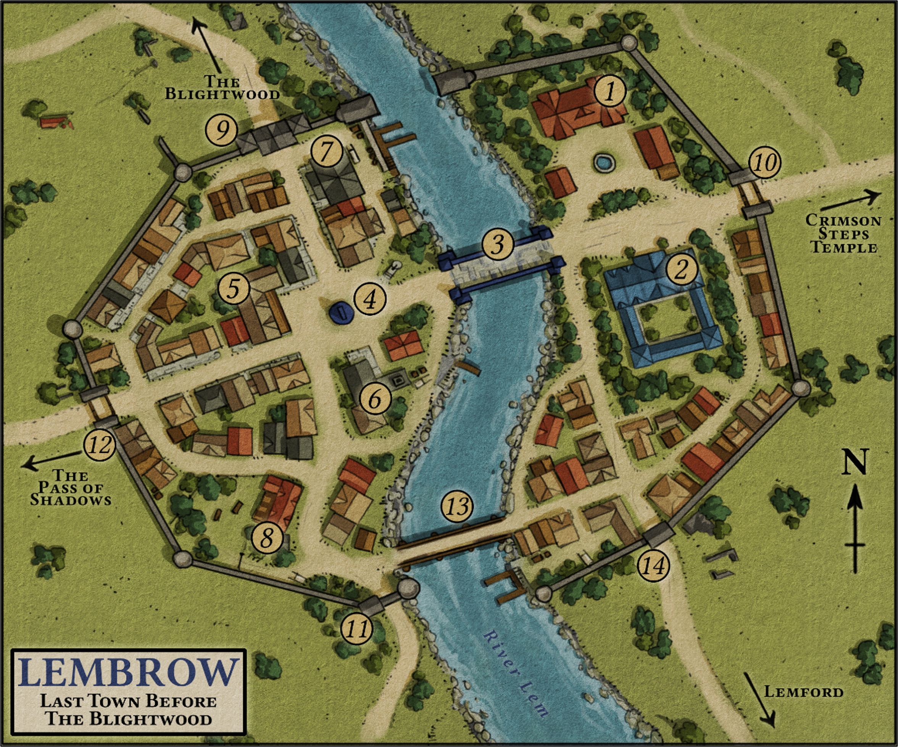

<!-- summary -->

Nestled in the [Valley of Lem](locations/valley-of-lem), where the woodland gives way to grassland, near the confluence of the rivers [Lem](locations/valley-of-lem/r-lem) and [Telling](locations/valley-of-lem/r-telling), we find the fortified town of Lembrow. A high stone wall with five stone turrets is a lot for a town of this size, but this close to the [Blightwood](locations/blightwood), you can never be too secure.

Where other towns might have small houses or farmsteads scattering the fields that surround the town centre, or even nestled up against the outer walls, Lembrow has nothing. Though the occasional crumbling ruin of a barn or farmhouse in the outskirts of the town is a reminder that this was not always the case.

At dawn every day bells ring out from the South tower, which marks the beginning of another day for the townsfolk of Lembrow; another day survived on the border of the Blightwood. The guards open the gates, the blacksmith lights his forge, and of blue-robed figures emerge from a large stone building - [the Sanatorium](locations/valley-of-lem/lembrow-sanatorium) - and begin walking the streets, collecting tithes for the [Church](organisations/church-of-brightwater).

<!-- /summary -->

# History

It is thought that some form of human settlement has existed here since at least the early days of the Erranite Empire. The longstanding Old Bluestone Bridge marks a stop along the road from the Imperial heartland around Vilras to valuable mines in Tel Valley. Indeed, the "*brow*" component of the town's name (which rhymes with *low*, never *how*) likely derived from an Old Common word meaning "bridge".

For much of its history, Lembrow was a small, peaceful village under the protection of the Duchy of Lem, conveniently located at a crossroads for travellers, and more famous for its trout fishing industry than anything else.

But in the years following the Fall of the Duchy, the Blightwood claimed much of the Upper Valley, its border drawing closer by the day. Lembrow soon became the Lower Valley's first defence against the encroaching threat. Sturdy fortifications were built, a Sanatorium was commissioned to tend to the afflicted, and Blessed Defenders recruited to fight off attacks.

# Notable Locations

*Map of Lembrow*

1. **Mayoral Residence** - The current mayor is an elderly recluse who is rarely seen outside his home. Management of the town and its defences is mostly just left to the Mother Overseer of the Sanatorium
2. **Lembrow Sanatorium** - Run by Blessed Mother Mariah Fairford. Its quaint courtyard makes this one of the more pleasant sanatoria to find oneself convalescing.
3. **Old Bluestone Bridge** - The oldest structure in the town, a remnant of Ancient Imperial infrastructure, yet it looks brand new.
4. **Market Square & Blessed Memorial** - The central bluestone pillar is carved with the names of the Blessed Defenders who have given their lives protecting the settlement and its people.
5. **The Golden Trout Tavern** - Run by the ever-friendly innkeeper, [Lilian Seylow](people/lilian-seylow).
6. **Frangus' Forge** - Owned by the dwarf blacksmith [Frangus](people/frangus-the-cured).
7. **Rivermen's Hall** - An assembly hall for the [Anglers' Guild](organisations/guilds#section-the-angler-s-guild).
8. **Jenara's Stables** - Also home to [Ingram Rothfuss](people/ingram-rothfuss), the Blessed Mother's wagoner.
9. **North Gate & Guardhouse**
10. **East Gate**
11. **Old South Gate**
12. **West Gate**
13. **New South Gate**
