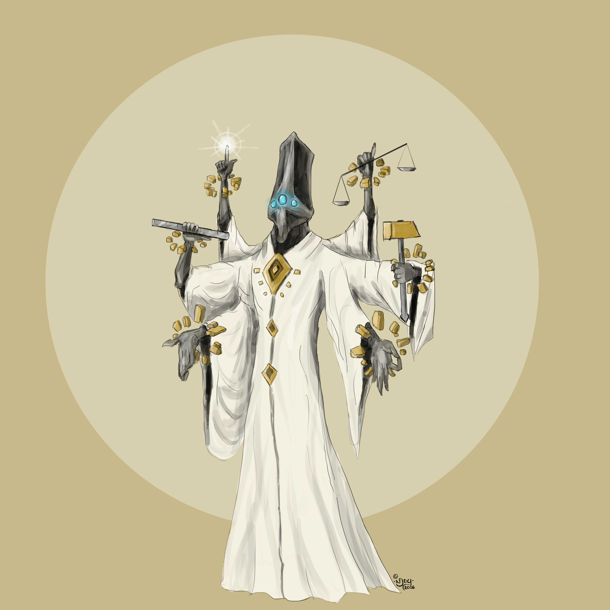
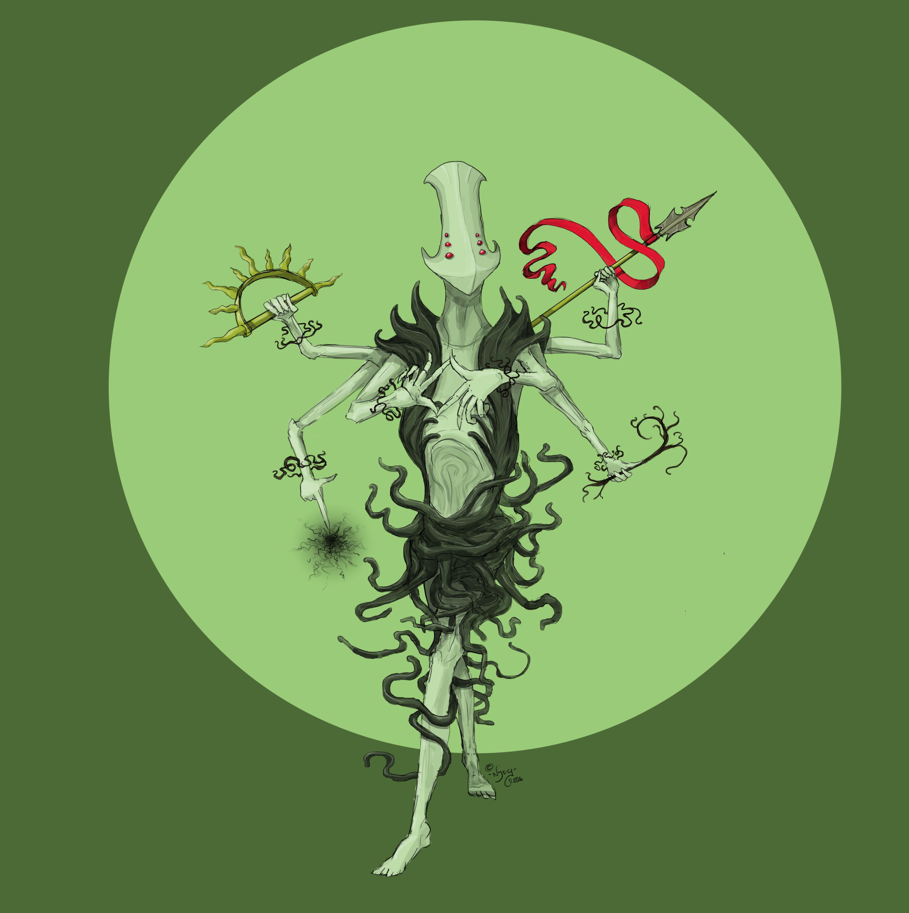

# The Order of Scarlet

> "By the Gods' hands you were created, and by them you shall be destroyed! [Akkamon](lore/akkamon), guide my weapon! [Ithikku](lore/ithikku), make it hurt!"
>
> — Battle-Priest [Olfrid Aumbric](people/olfrid-aumbric) of the [Crimson Steps Temple](locations/valley-of-lem/the-crimson-steps-temple)

There are many across [Erran](locations) who believe [Silverblight](lore/silverblight) to be a punishment sent by the Gods. Those that believe they can do something about it may be persuaded to join the scattered yet enduring temples of the Order of Scarlet.

Records suggest that the Order was established in the dying days of the [Erranite Empire](history/erranite-empire), shortly after the hypothesised event which precipitated the arrival of Silverblight, which the priests call "The [Great Betrayal](history/great-betrayal)". Exactly what constituted the betrayal has been a source of great debate among the theologians of the Order for generations, but it is universally agreed to feature greed and hubris to the highest order.

The Order generally operate in isolated temples, at a distance from the nearest settlement and designed to be self-sufficient. They continue to worship the [Old Gods](lore/old-gods) of the Erranite Empire, primordial entities whose boons are crude in nature, but powerful. Their divine blessings provide further protection from the Blight. This is though to be the primary reason that the Order has persisted through the [Years of Darkness](history/years-of-darkness), in some locations nearly continuously for hundreds of years.

Nevertheless, the Years of Darkness were still dark times for the Order. To atone for their punishment sent by the Gods, the High Priests of old demanded redemption through pain and sacrifice. At the peak of the Order's power and influence, a High Priest might come to a village to slaughter a newborn in front of the townsfolk, who would then be made to flagellate themselves, claiming this as the only true path to salvation from the Blight. It is from this grisly chapter of the Order's history that it is associated with "Scarlet".

Since the advent of the [Church of Brightwater](organisations/church-of-brightwater) and [Reversing Elixir](lore/reversing-elixir), the Order has mellowed somewhat, with many temples changing focus from reaping mortal souls to reaping bountiful harvests, and teaching the virtues of generosity, frugality, and humility alongside the physical training and discipline required for their battle-monks.

## Locations

Unlike the [Church of Brightwater](organisations/church-of-brightwater), the Order's temples do not exist as part of some larger network, and as such each operates under its own unique structures and traditions, nor is there particularly are hierarchy between them beyond their age and size.

### The Crimson Steps Temple

* **Location:** [Telling Valley](locations/valley-of-lem/telling-valley)
* **Inhabitants:** c. 300-500
* **Principal Gods:** [Akkamon](lore/akkamon), [Ithikku](lore/ithikku), [Orim](lore/orim), [Onu](lore/onu)
* **Functions:** Farming, martial training

### The Temple of the Ruby Chalice

* **Location:** The [Lotharian Mts.](locations/lotharian-mountains)
* **Inhabitants:** ???
* **Principal Gods:** [Ghelothar](lore/ghelothar), [Akkamon](lore/akkamon)
* **Functions:** Arcane study, martial training

### The Old Rose Garden

* **Location:** [Klathras](locations/plains/klathras)
* **Inhabitants:** c. 100
* **Principal Gods:** [Varothar](lore/varothar), [Ithikku](lore/ithikku)
* **Functions:** Trade

## The Old Gods

Each tied to a fundamental aspect of nature, the worship of the [Old Gods](lore/old-gods) dates back to long before the [Erranite Empire](history/erranite-empire). Indeed, they are believed to have some hand in the creation of the world itself, and the inhabitants therein.

Duality is a key concept in the theology surrounding the Old Gods - it is no coincidence that they come in pairs.

### Akkamon and Ithikku

*[Akkamon](lore/akkamon), the God of Order*

*[Ithikku](lore/ithikku), the God of Chaos*

### Orim and Onu

Earth and Sky

### Ghelothar and Varothar

Mountain and Sea

more?
